# موقع د. أحمد على iPhone Duo — الامتداد الكامل والتكيّف (13 نوفمبر 2026)

نطاق الجولة طبقة العرض فقط: CSS في [src/index.css](../src/index.css) و[src/pages/mihwar.css](../src/pages/mihwar.css) و[src/pages/mihwar-gate.css](../src/pages/mihwar-gate.css)، وخطّاف واحد لحفظ موضع القراءة [src/lib/keep-reading-place.ts](../src/lib/keep-reading-place.ts)، وأسماء أصناف (class) في ثلاث صفحات. لم يُمَسّ المصادقة ولا Firestore ولا قواعده ولا الخادم ولا البيانات ولا ملفات النشر ولا الأسرار.

ملف التعليمات الرئيسي (`~/Desktop/00_MASTER_CLAUDE_CODE_AR.txt`) لم يكن موجوداً على القرص وقت العمل، فاتُّبعت تعريفات الوضعيات A–J المستعملة في بقية المستودعات ومواصفة `DUO_BRIEF.md`.

رموز الحالة: `PASS` مُختبَر ومُشاهَد، `PARTIAL` تحسّن جزئي، `FAIL` خلل باقٍ، `BLOCKED` يحتاج جهازاً أو علماً، `NOT_APPLICABLE` غير ذي صلة، `NOT_TESTED` لم يُختبر.

## 1. المشروع ومسار النشر

- React 19 + Vite 8 + Tailwind 3، موقع ثابت مبني مسبقاً (`build-static`) على Firebase Hosting.
- **النشر الفعلي:** workflow «نشر الموقع على Firebase Hosting» ([.github/workflows/firebase-hosting-live.yml](../.github/workflows/firebase-hosting-live.yml)) يعمل عند كل دفع إلى `main` يمسّ غير التوثيق (منذ #223)، ويسبقه job «gate». `vercel.json` بقايا ولا يُنشر منه شيء. لم يُعدَّل أي ملف نشر.
- **مِحور** (`/mihwar`) تطبيق داخل Shadow DOM خاص بالمالك؛ اختُبر في وضع العرض التجريبي (`VITE_DEMO_MODE=1`) ببيانات وهمية فقط، فظهرت حالته الفارغة («لا مواد مطابقة») وتنبيه «لم يعمل الجالب الدوري بعد».

## 2. خط الأساس قبل التعديل (`origin/main` = `75f2ec82`)

| الفحص | النتيجة |
|---|---|
| `npm ci` | PASS |
| بوابة النشر على `main` (gate + build-and-deploy، تشغيلة 43422056875) | PASS |
| `npm run build` محلياً | لم يكتمل نظيفاً: الجهاز محمّل بجلسات متوازية، وبدأ التعديل قبل انتهائه، فاعتُمدت بوابة CI على نفس الالتزام خطاً للأساس. ملاحظة: البناء المحلي يعيد كتابة ملفات `src/data/*.json` المتتبَّعة ويولّد صوراً في `covers/`، وأُرجعت كلها قبل الالتزام |
| `node scripts/test-conversation-notes-20260810.mjs` | FAIL **سابق**: يبحث عن نص `rail-swipe-discovery__label` في `src/App.tsx` الذي لم يُمَسّ. ليس ضمن بوابة النشر |
| مصفوفة WebKit (12 مقاساً × 6 صفحات) | 0 تمرير أفقي، 0 عناصر خارج الشاشة. العيوب في القسم 3 |

## 3. ما وُجد وما أُصلح من جذوره

| # | العَرَض (قبل) | الجذر | الإصلاح |
|---|---|---|---|
| 1 | **موضع القراءة يضيع** عند الفتح/الطي/تبديل Split: فقرة عند y=140 في 951 صارت عند 73 (669)، 262 (470)، **499 من 580** (382)، **25** (600×350) | المتصفح يحفظ `scrollY` بالبكسل، والنص يطول أضعافاً حين يضيق العرض. WebKit لا يطبّق scroll anchoring على تغيّر العرض (قِيس) | `useKeepReadingPlace('article-body')`: يتذكّر الفقرة التي تحت خط القراءة ونسبة ما قُرئ منها، ويعيدها إلى الموضع نفسه بعد إعادة التخطيط. لا يتفاعل مع تغيّر الارتفاع وحده (شريط Safari)، ويتجاهل أحداث التمرير التي يطلقها المتصفح أثناء التحجيم |
| 2 | رأس الصفحات الداخلية (البحث، المقالات…) على 600×350 بارتفاع 384px: أطول من النافذة، والبحث والمحتوى تحت الحافة | `.page-head-scene` بحد أدنى `clamp(22rem, 48vh, …)` = 352px وحشو علوي 7.5rem `!important` — مصمَّم لشاشة طولية | تحت `max-height: 480px`: `min-height: 0` وحشو 5.25rem/2rem. الرأس 330px والعنوان من y=155 إلى 114 |
| 3 | عنوان المقال على 600×350 يبدأ عند y=221 | `pt-32` ثابت (128px) فوق الشريط الثابت | `.article-shell` بحشو 5.25rem في الارتفاع المضغوط: العنوان عند y=169، وعلى الآيفون العرضي 177→123 |
| 4 | صفحة 404 على 600×350: لا شيء من النص في الشاشة الأولى | `pt-36` + رقم 404 بحجم 15vw | `.not-found-stage` مضغوطة في الارتفاع القصير: العنوان عند y=132 |
| 5 | مِحور على 600×350: الشريط السفلي يأخذ 58px من 350، والرأس نصف الشاشة | نقطة التحول إلى الهاتف عرضية فقط (≤680) | في `(max-width:680) and (min-width:520) and (max-height:480)` يصير الشريط السفلي **عموداً جانبياً** على جهة البداية (كما يفعل النظام بأشرطته في الشاشة الخارجية)، ويُضغط الرأس في كل ارتفاع قصير |
| 6 | مِحور: قائمة الترتيب أقصر من «الفلاتر» وحقل البحث (كل المقاسات) | WebKit يتجاهل `min-height` على `<select>` الأصلي | `appearance: none` بسهم SVG مضمَّن؛ الارتفاع 50px مطابق للجيران |
| 7 | بوابة دخول مِحور: `place-items:center` داخل حاوية تمرير تقصّ أعلى البطاقة حين تكون أطول من النافذة | توسيط grid غير آمن | flex عمودي + `margin:auto` للطفل: يتوسّط حين تتسع المساحة ويبدأ من الأعلى حين تضيق، مع حواف أمان |
| 8 | `.app{min-height:100vh}` في مِحور | 100vh في Safari هو الارتفاع الأكبر | `min-height:100%` داخل الإطار الثابت |
| 9 | حواف الأمان الجانبية غير محسوبة (الشريط العلوي، المحتوى، مِحور، الدرج، التنبيه) | `viewport-fit=cover` دون `env(safe-area-inset-left/right)` | `body` يأخذ الحافتين (الخلفية تبقى ممتدة حتى الحافة لأن لون body ينتقل إلى canvas)، والشريط الثابت والدرج والتنبيه وأعمدة مِحور تأخذ حدودها. لا فرق حين تكون الحواف صفراً |
| 10 | وضع الكتاب: عنوان المقال وفقراته وزر الاستماع تعبر المفصل (5 عناصر)، وفي 404 ثمانية | لا تحسين تدريجي لـ Viewport Segments | `@media (horizontal-viewport-segments: 2)`: عمود القراءة كله في المقطع الأيمن (بداية القراءة بالعربية). دون الـ API لا تُطبَّق الكتلة |

## 4. الامتداد الكامل

| البند | الحالة | الدليل |
|---|---|---|
| خلفية الجذر | PASS | `body` بلون `--c-canvas` ينتقل إلى canvas، ولا `overflow:hidden` على الجذر (`overflow-x: clip` فقط) |
| حواف الأمان | PASS (مراجعة كود) | حواف Playwright دائماً صفر، فالقيم غير الصفرية لم تُقَس على جهاز |
| `100vh` | PASS | لا `100vh` في تخطيط الموقع؛ مِحور صار `100%` |
| تمرير أفقي | PASS | 0 في كل المقاسات والصفحات قبل وبعد |
| لون شريط النظام | PASS | `theme-color` يتبدّل مع الوضع الليلي (قائم سابقاً) |
| لوحة المفاتيح | NOT_TESTED | لا لوحة مفاتيح حقيقية في المحاكاة |

## 5. مصفوفة الوضعيات A–J

المنصة: Playwright WebKit (build 2370)، ملف Safari المحمول (UA Duo، لمس، DPR 2، تقليل الحركة)، خادم Vite بوضع العرض التجريبي. الصفحات: الرئيسية، المقالات، مقال (القارئ)، مِحور، بحث بلا نتائج (حالة فارغة)، 404 (حالة خطأ).

| الوضعية | المقاس | الرئيسية | المقالات | المقال/القارئ | مِحور | بحث فارغ | 404 | الحالة |
|---|---|---|---|---|---|---|---|---|
| A مطوي طولي | 382×580 | ✓ | ✓ | ✓ | ✓ | ✓ | ✓ | PASS (محاكاة) |
| B مطوي عرضي | 600×350 | ✓ | الرأس 384→330px | العنوان y 221→169 | عمود جانبي بدل الشريط السفلي | الرأس 384→330px | العنوان في الشاشة الأولى (y=132) | PASS، والرأس الداخلي PARTIAL |
| C مفتوح طولي | 669×880 | ✓ | ✓ | ✓ | ✓ | ✓ | ✓ | PASS (محاكاة) |
| C مع عنصر مثبت | 669×520 | ✓ | ✓ | ✓ | ✓ | ✓ | ✓ | PASS (محاكاة) |
| D مفتوح عرضي | 951×600 | ✓ | ✓ | ✓ | ✓ | ✓ | ✓ | PASS (محاكاة) |
| E كتاب | 669×880 + مفصل x=334 | — | — | عناصر تعبر المفصل 5→0 | — | — | 8→0 | PASS في **محاكاة Chromium** (`Emulation.setDeviceMetricsOverride.displayFeature`)؛ على Safari 27.1 الـ API خلف علم: BLOCKED على الجهاز |
| F طاولة | 951×600 + مفصل y=300 | الصفحة تتمرر | | | | | | PARTIAL: الصفحات قابلة للتمرير فلا شيء يُثبَّت عن المفصل؛ لا عنصر تفاعلي يعبره في الشاشة الأولى (فحص آلي) |
| G نافذتان | 385×571 | ✓ | ✓ | ✓ | ✓ | ✓ | ✓ | PASS (محاكاة) |
| H Split | 320 / 470 / 620 ×600 | ✓ | ✓ | ✓ | ✓ | ✓ | ✓ | PASS (محاكاة) |
| I خيمة/حامل | — | | | | | | | NOT_TESTED: لا runtime يعلن هذه الوضعية |
| J انتقال حي | 951→669→470→382→600×350→951 بلا إعادة تحميل | | | الفقرة المقروءة عند y=120/121/120/88/121 (قبل: 73/262/**499**/**25**/141) | | | | PASS |

إضافةً: iPhone 15 (393×659) وiPhone 15 عرضياً (852×393) وسطح المكتب 1440×900: كلها بلا تمرير أفقي ولا أخطاء JS. على الآيفون العرضي: المقال 177→123–167 (حسب تحميل شارة الإحصاءات)، والرأس الداخلي 377→341px، ومِحور بترتيب مطابق الارتفاع. سطح المكتب بلا تغيير مرئي.

العدّاد الآلي بعد التعديل (72 لقطة): 0 تمرير أفقي، 0 عناصر خارج الشاشة، 0 أخطاء صفحة، 0 أهداف لمس صغيرة في الشاشة الأولى خارج النصوص (عدا رابط واحد في بحث 669 قائم قبل التعديل).

## 6. صور قبل/بعد

| الحالة | قبل | بعد |
|---|---|---|
| B مِحور 600×350 | 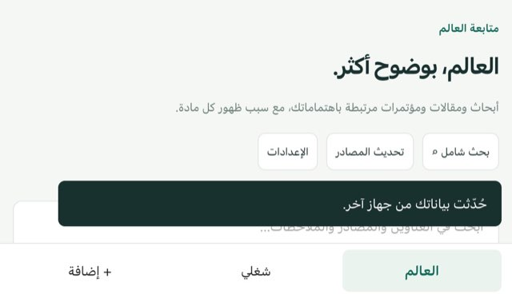 | 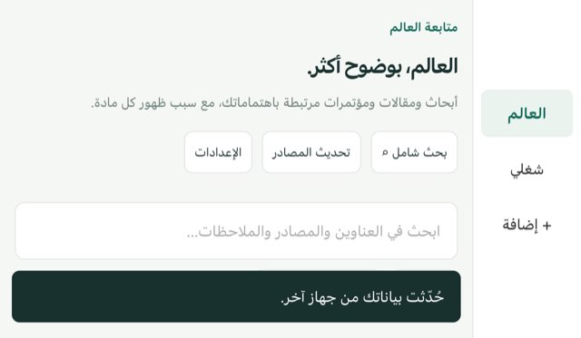 |
| B مقال 600×350 | 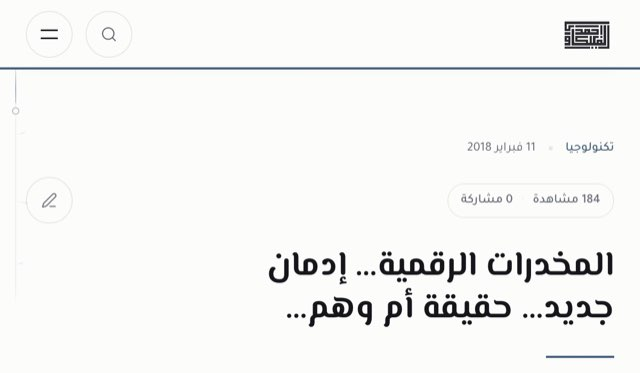 | 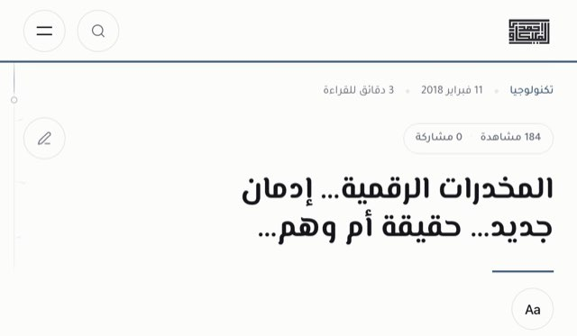 |
| B 404 600×350 | 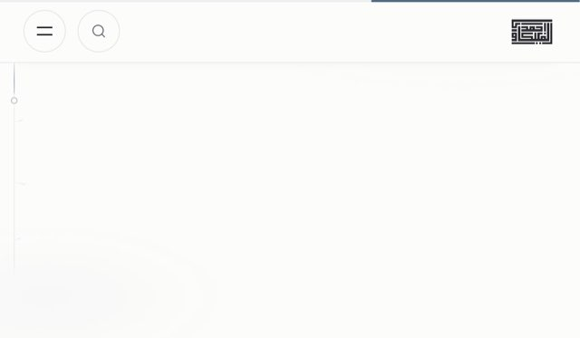 | 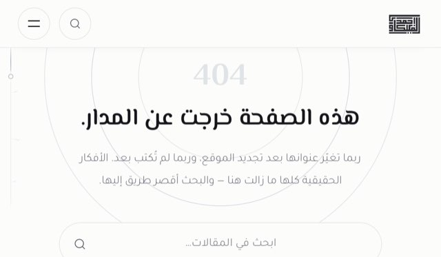 |
| B بحث فارغ 600×350 | 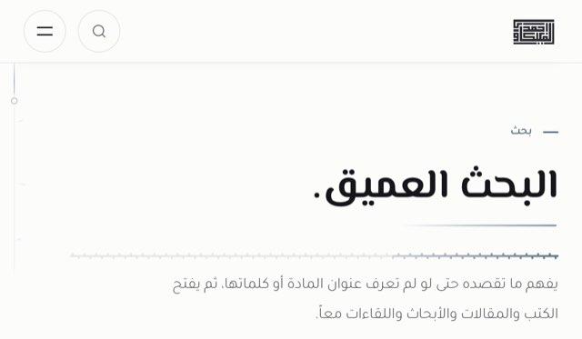 | 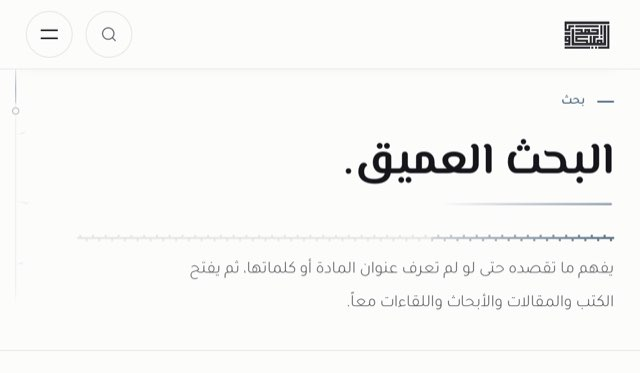 |
| آيفون عرضي، مِحور | 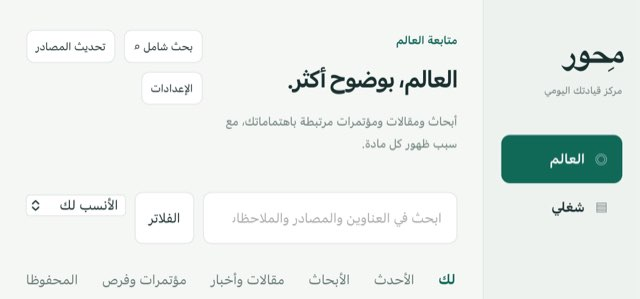 | 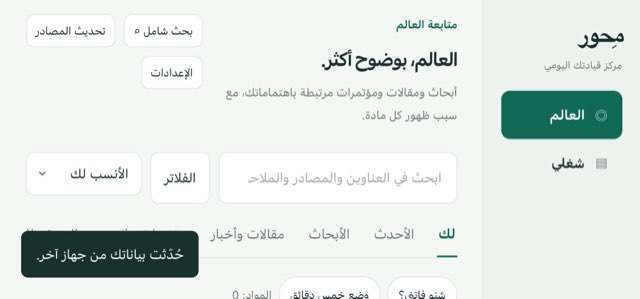 |
| J بعد الانتقال إلى 382×580 | 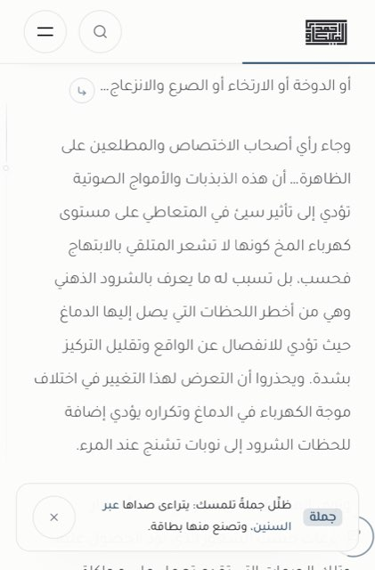 | 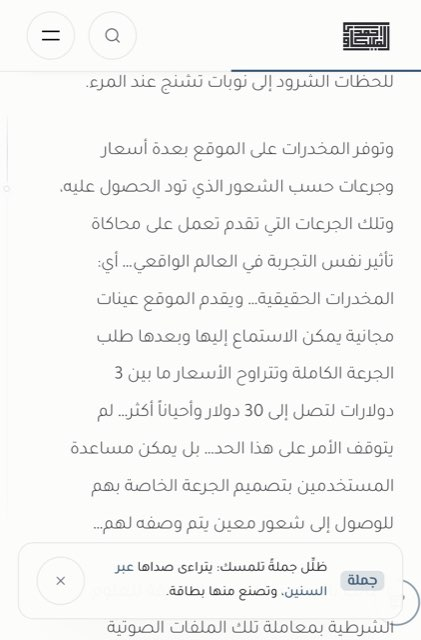 |
| E كتاب (محاكاة Chromium) | 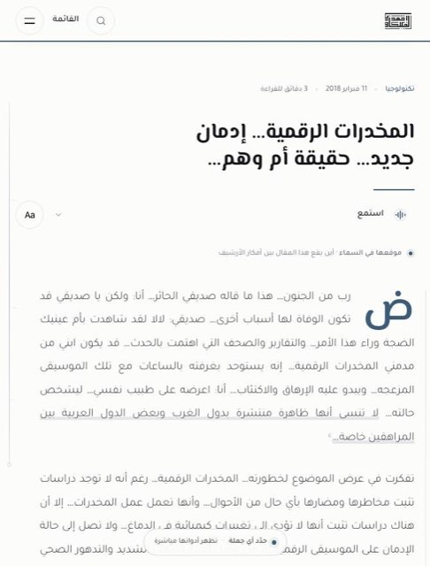 | 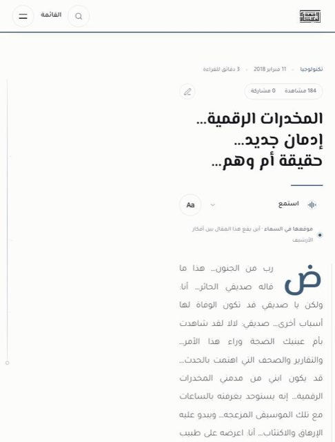 |

## 7. الوصول والاتجاه

- RTL: كل الصفحات `dir=rtl`، والقاعدة الجديدة للمفصل تضع النص في مقطع البداية. PASS.
- التكبير غير مقفول (`width=device-width, initial-scale=1.0, viewport-fit=cover`). PASS.
- أهداف اللمس: لا عناصر تفاعلية أصغر من 32px في الشاشة الأولى في أي حالة (فحص آلي)، وأزرار عمود مِحور الجانبي ≥ 48px. PASS.
- تقليل الحركة: الخطّاف الجديد يمرّر بـ `behavior: instant`، فلا حركة. PASS.
- VoiceOver حقيقي: NOT_TESTED.

## 8. الاختبارات بعد التعديل

| الأمر | النتيجة |
|---|---|
| `npx tsc --noEmit` (`npm run lint`) | PASS |
| `npm run mihwar:test` | PASS |
| حراس البناء التي تقرأ الملفات المعدّلة: `guard-critical-bridges`، `guard-arabic-tanween`، `guard-arabic-typography`، `guard-design-system`، `guard-visual-tokens` | PASS |
| `test-all-user-notes`، `test-site-polish-2026`، `test-final-polish-2026`، `test-concept-weave`، `test-journey-stepper`، `test-final-user-notes-2026-08-09`، `test-requested-improvements-2026`، `test-book-knowledge-integration` | PASS |
| `test-conversation-notes-20260810` | FAIL سابق لا علاقة له (يفحص `src/App.tsx` غير المعدَّل) |
| `npm run build` الكامل | يعمل في بوابة النشر على CI (gate ثم build-and-deploy) |
| مصفوفة WebKit + الانتقال الحي + محاكاة المفصل | انظر القسم 5 |

## 9. القيود وما يجب فحصه على جهاز حقيقي

1. Safari 27.1: `Viewport Segments` و`Device Posture` خلف علم؛ كتلة المفصل لا تعمل إلا بتفعيله، ودونه يبقى التخطيط العادي المختبَر أعلاه.
2. محاكاة Playwright ليست جهازاً: الحواف غير المتماثلة وعمود Safari الجانبي ولوحة المفاتيح لم تُقَس.
3. على محاكي/جهاز Duo: (أ) افتح مقالاً طويلاً، اقرأ إلى منتصفه، ثم اطوِ الجهاز وافتحه: هل تبقى الفقرة نفسها أمامك؟ (ب) المطوي عرضياً على `/mihwar` (بعد الدخول): هل الشريط عمود جانبي على اليمين؟ (ج) المطوي عرضياً على `/search`: هل يظهر العنوان والوصف دون أن يملأ الرأس الشاشة؟ (د) فعّل علم Viewport Segments وافتح مقالاً كالكتاب: هل النص كله على النصف الأيمن؟
4. رأس الصفحات الداخلية على 350px ما زال يملأ الشاشة الأولى تقريباً (330px) لأن فيه عنواناً ضخماً وخطاً زخرفياً ووصفاً؛ تقليص الطباعة نفسها قرار هوية تُرك للمالك (PARTIAL).
5. مِحور الحقيقي (بيانات المالك وFirestore) لم يُفتح: الاختبار بوضع العرض التجريبي فقط.
